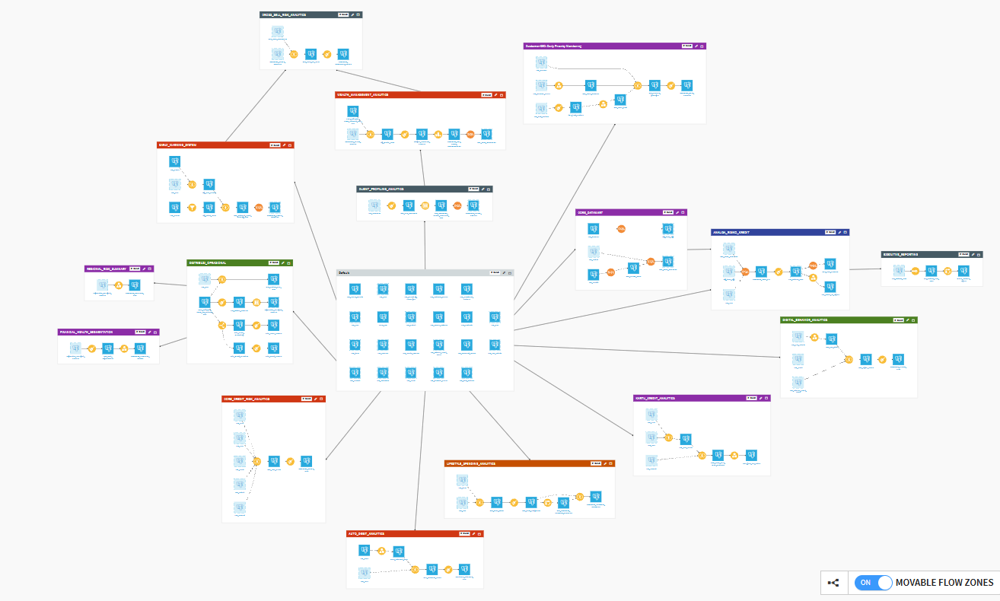
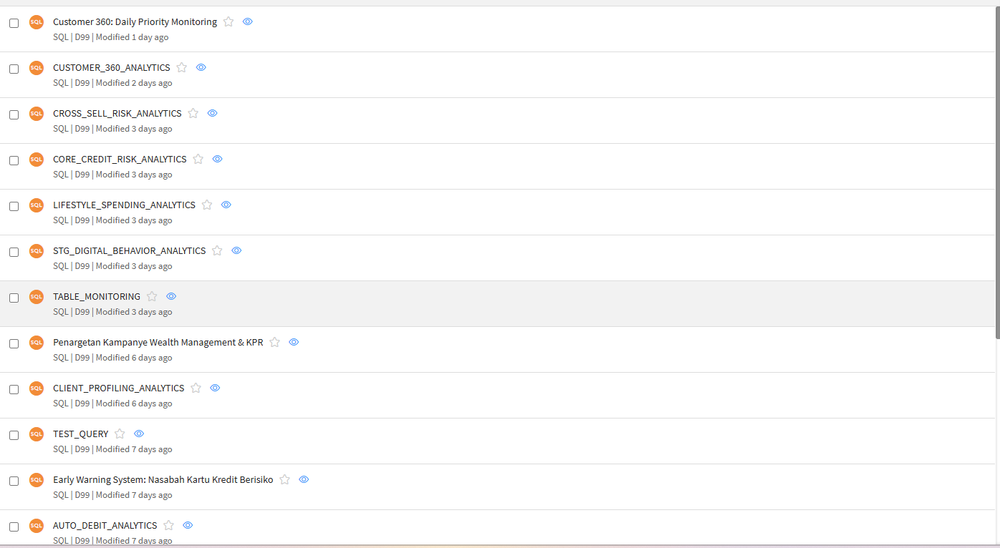
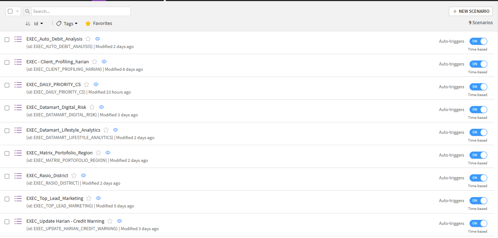
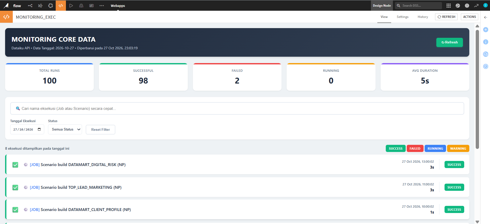

# Automated Dataiku ETL Pipeline & Monitoring Dashboard

Repositori ini berisi arsitektur *Data Engineering* *end-to-end* untuk memproses, mengotomatisasi, dan memonitor data operasional harian (Customer 360). Proyek ini menggunakan **PostgreSQL (Supabase)** sebagai sumber data utama, **Dataiku DSS** sebagai mesin ETL (*Extract, Transform, Load*) & Orkestrasi, serta **Python/Flask + JS** untuk Dasbor Monitoring *real-time*.

## Arsitektur & Alur Kerja (Workflow)
1. **Data Ingestion (SQL):** Menarik data mentah (Profil Nasabah, Transaksi Harian, dan Tiket Komplain) dari *database* relasional.
2. **Data Transformation (Dataiku Flow):** Membangun zona analitik yang kompleks menggunakan *Visual Recipes* (Join, Grouping, Formula) dan *SQL Scripting* (CTE) untuk menghasilkan `DATAMART_DAILY_PRIORITY`. Datamart ini berfungsi mendeteksi nasabah VIP/Premium yang memiliki keluhan berstatus *Open* (URGENT).
3. **Orchestration (Scenarios):** Menjadwalkan pembaruan data otomatis menggunakan fitur *Time-based Trigger* dan *Force-build dependencies* di Dataiku.
4. **Monitoring (Webapp):** Dasbor kustom interaktif untuk melacak status "jantung" sistem (Jobs & Scenarios) secara *real-time* menggunakan Dataiku API.

---

## Visualisasi Arsitektur

### 1. Dataiku Flow & Relasi Zona
Rangkaian *pipeline* data skala besar yang dipisahkan ke dalam berbagai zona analitik (Financial Health, Digital Behavior, Client Profiling, dll).

### 2. SQL Scripting & Transformasi
Penggunaan *Common Table Expressions* (CTE) untuk kalkulasi metrik agregasi pra-transformasi.

### 3. Orkestrasi (Automated Scenarios)
Daftar Skenario otomatis yang bertugas melakukan *rebuild* (menjalankan ulang) seluruh dataset turunan secara berkala.

### 4. Custom Monitoring Dashboard (Webapp)
Dasbor *real-time* yang dibangun dengan HTML/CSS/JS (Frontend) dan Python (Backend) untuk menyaring dan menampilkan hasil eksekusi *pipeline* secara elegan.

---

## Teknologi yang Digunakan
* **Database & Storage:** PostgreSQL (Supabase)
* **ETL & Data Science Platform:** Dataiku DSS
* **Database Management:** DBeaver
* **Web & API Backend:** Python (Flask), Dataiku API
* **Frontend Dashboard:** HTML5, CSS3, JavaScript (Vanilla)

## Fitur Utama
* **Smart Flagging:** Mesin *scoring* otomatis untuk menentukan tingkat prioritas penanganan nasabah (URGENT / Warning / Aman).
* **Force-build Synchronization:** Memaksa penarikan data segar dari SQL *database* setiap kali *trigger* waktu berjalan.
* **Server-side Filtering:** Optimasi API *backend* yang hanya menarik data eksekusi (log) sesuai dengan tanggal yang diminta *client* agar beban *server* tetap ringan.
